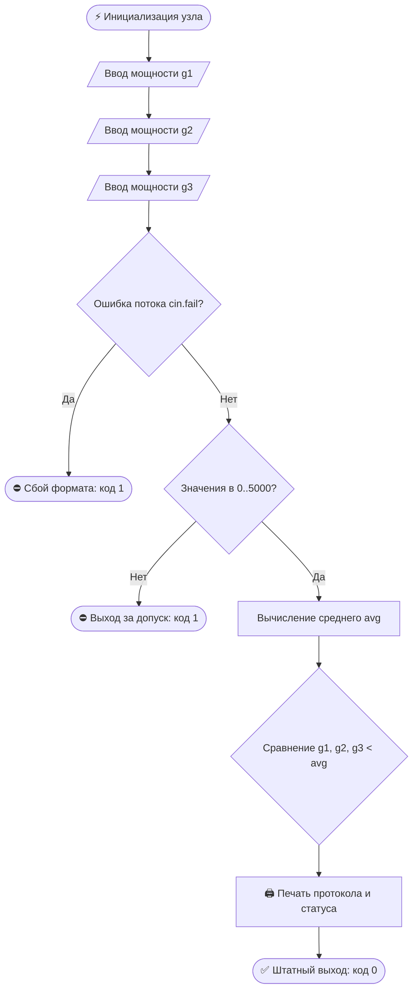

# 🌆 CYBERGRID // ЭНЕРГОСЕТЬ КИБЕРПАНКА
### _Терминал диспетчерского контроля и телеметрии неонового сектора (C++17)_

> [!ABSTRACT]+ 📡 Перехват радиоэфира вышки Сектора-7
> _«Пока неон горит над нижними уровнями — компилятор не выдаёт ни одного предупреждения.»_
> — гравировка на консоли старшего инженера сети

> [!INFO]- 🗂️ Навигация по терминалу
> - [[#🌃 Вводная сводка|Вводная сводка]]
> - [[#⚙️ Функциональный модуль|Функциональный модуль]]
> - [[#📊 Технический регламент|Технический регламент]]
> - [[#📐 Математическое ядро|Математическое ядро]]
> - [[#💻 Компиляция и запуск|Компиляция и запуск]]
> - [[#🖥️ Лог работы консоли|Лог работы консоли]]
> - [[#🛡️ Протоколы безопасности|Протоколы безопасности]]
> - [[#🧬 Схема архитектуры|Схема архитектуры]]
> - [[#💾 Исходный код (main.cpp)|Исходный код]]
> - [[#🚀 Вектор развития|Вектор развития]]

---

## 🌃 Вводная сводка

Глубокая ночь в мегаполисе. Голографические билборды мерцают на грани отключения, реакторы работают на пределе, а дежурный оператор снова пытается в уме прикинуть баланс фаз и теряет сотые доли мегаватт.

==«Энергосеть Киберпанка»== — автономный консольный узел мониторинга. Программа принимает показания трёх магистральных генераторов, рассчитывает среднюю нагрузку по району и моментально подсвечивает просевшие энергоблоки для бригады техников.

---

## ⚙️ Функциональный модуль

- [x] **Телеметрия:** считывание текущей выработки трёх генераторов района (в МВт) ⚡
- [x] **Контроль допусков:** отсечка аномалий за пределами рабочего окна `0.0 — 5000.0 МВт`
- [x] **Аналитика:** вычисление среднего энергопотребления по всему сектору
- [x] **Детектор просадок:** поиск всех узлов, чья мощность упала ниже среднего уровня (`g < avg`)
- [x] **Приоритет ремонта:** автоматический выбор первого проблемного генератора для диагностики
- [x] **Системные коды:** возврат `0` при штатной работе и `1` при сбое ввода или перегрузке линии

---

## 📊 Технический регламент
> Все расчёты производятся в мегаваттах (МВт) с точностью до двух знаков после запятой[^1].

| Код | Параметр системы | Номинал | Примечание диспетчера |
| :-: | ---------------- | ------: | --------------------- |
| `01` | 📉 Нижний порог (`P_MIN`) | `0.0 МВт` | Холостой ход турбины или полная остановка блока |
| `02` | 📈 Верхний порог (`P_MAX`) | `5000.0 МВт` | Критический предел прочности силовых магистралей |
| `03` | 🏭 Контур генерации | `3 узла` | Базовая архитектура питания одного городского сектора |

> [!TIP] Быстрая реконфигурация
> Рабочие границы заданы константами `P_MIN` и `P_MAX` в самом начале функции `main()`. Вы можете изменить пороги безопасности под другой район, не трогая алгоритмы расчёта.

---

## 📐 Математическое ядро

Расчёт опорного среднего значения по трём линиям:
$$\text{avg} = \frac{g_1 + g_2 + g_3}{3.0}$$

Условие срабатывания тревоги `[ALERT]` для каждого блока:
$$g_i < \text{avg}, \quad i \in \{1, 2, 3\}$$

| Идентификатор | Описание переменной |
| :-----------: | ------------------- |
| $g_1, g_2, g_3$ | текущая выходная мощность генераторов #1, #2 и #3 (МВт) |
| $\text{avg}$ | среднее потребление энергии по району (МВт) |
| $\text{criticalCount}$ | счётчик генераторов с критической просадкой |
| $\text{firstCritical}$ | индекс первого обнаруженного сбойного генератора |

> [!EXAMPLE]- 🧾 Тестовый прогон (1200 / 850 / 1550 МВт)
> * **Расчёт среднего:** $\text{avg} = \frac{1200 + 850 + 1550}{3.0} = \mathbf{1200.00\text{ МВт}}$
> * **Анализ блоков:** у **генератора #2** зафиксирована просадка ($850.00 < 1200.00$)
> * **Вердикт системы:** отправить ремонтного дрона к **генератору #2**

---

## 💻 Компиляция и запуск

Сборка выполняется любым современным компилятором с поддержкой стандарта **C++17** без сторонних библиотек:

```bash
# Компиляция бинарного файла
g++ -std=c++17 -O2 -o cybergrid main.cpp

# Запуск в Linux / macOS
./cybergrid

# Запуск в Windows (PowerShell / CMD)
.\cybergrid.exe
```

> [!NOTE] Сборка в Visual Studio
> Создайте пустой консольный проект C++, добавьте файл `main.cpp` и нажмите `Ctrl + F5`. Используются исключительно стандартные заголовки `<iostream>` и `<iomanip>`.

> [!NOTE]- Кодировка и форматирование вывода
> Функция `setlocale(0, "")` в начале программы автоматически подстраивает вывод кириллицы под системную локаль Windows[^2]. Точность вывода фиксируется манипуляторами `std::fixed` и `std::setprecision(2)`.

---

## 🖥️ Лог работы консоли

```text
=============================================
  ЭНЕРГОСЕТЬ КИБЕРПАНКА // MONITORING NODE   
=============================================
Введите мощность генератора #1 (МВт): 1200
Введите мощность генератора #2 (МВт): 850
Введите мощность генератора #3 (МВт): 1550

--- ПРОТОКОЛ МОНИТОРИНГА РАЙОНА ---
Генератор #1: 1200.00 МВт
Генератор #2: 850.00 МВт
Генератор #3: 1550.00 МВт
Среднее потребление района: 1200.00 МВт
[ALERT] Генератор #2: выработка ниже среднего района (850.00 МВт)

[СТАТУС] Обнаружено критических генераторов: 1
Приоритетная диагностика: генератор #2.
Требуется перераспределение нагрузки по районам.
=============================================
```

---

## 🛡️ Протоколы безопасности

Поток ввода защищён проверкой флага `std::cin.fail()` и жёстким контролем диапазона. Любое отклонение от формата немедленно блокирует работу узла с кодом возврата `1`.

| Входные данные оператора | Реакция терминала | Код выхода |
| ----------------------- | ----------------- | :--------: |
| `1200`, `850`, `1550` | Формирование отчёта, вывод `[ALERT]` по блоку #2 | `0` |
| `1000`, `1000`, `1000` | Штатный режим: `[СТАТУС] Критических отклонений не обнаружено` | `0` |
| `error` / символы | `ОШИБКА Некорректный ввод: ожидалось число.` | `1` |
| `-50` (отрицательное) | `ОШИБКА Мощность вне допустимого диапазона (0-5000 МВт).` | `1` |
| `6500` (превышение) | `ОШИБКА Мощность вне допустимого диапазона (0-5000 МВт).` | `1` |
| Сигнал `EOF`[^3] | Аварийная остановка потока ввода (`std::cin.fail()`) | `1` |

---

## 🧬 Схема архитектуры



---

## 💾 Исходный код (main.cpp)

<details>
<summary>📂 <b>Открыть листинг программы на C++</b></summary>

```cpp
#include <iostream>
#include <iomanip>

int main() {

    setlocale(0, "");

    // диапазон мощности генератора
    const double P_MIN = 0.0;
    const double P_MAX = 5000.0;

    std::cout << "=============================================" << std::endl;
    std::cout << "  ЭНЕРГОСЕТЬ КИБЕРПАНКА // MONITORING NODE   " << std::endl;
    std::cout << "=============================================" << std::endl;

    double g1 = 0.0, g2 = 0.0, g3 = 0.0;


    std::cout << "Введите мощность генератора #1 (МВт): ";
    std::cin >> g1;
    if (std::cin.fail()) {
        std::cout << std::endl << "ОШИБКА Некорректный ввод: ожидалось число." << std::endl;
        return 1;
    }

    std::cout << "Введите мощность генератора #2 (МВт): ";
    std::cin >> g2;
    if (std::cin.fail()) {
        std::cout << std::endl << "ОШИБКА Некорректный ввод: ожидалось число." << std::endl;
        return 1;
    }

    std::cout << "Введите мощность генератора #3 (МВт): ";
    std::cin >> g3;
    if (std::cin.fail()) {
        std::cout << std::endl << "ОШИБКА Некорректный ввод: ожидалось число." << std::endl;
        return 1;
    }
    //Проверка диапазона
    if (g1 < P_MIN || g1 > P_MAX || g2 < P_MIN || g2 > P_MAX || g3 < P_MIN || g3 > P_MAX) {
        std::cout << std::endl << "ОШИБКА Мощность вне допустимого диапазона ("
            << P_MIN << "-" << P_MAX << " МВт). Мониторинг прерван." << std::endl;
        return 1;
    }

    // Расчет среднего потребления 
    double avg = (g1 + g2 + g3) / 3.0;

    std::cout << std::endl << "--- ПРОТОКОЛ МОНИТОРИНГА РАЙОНА ---" << std::endl;
    std::cout << std::fixed << std::setprecision(2);
    std::cout << "Генератор #1: " << g1 << " МВт" << std::endl;
    std::cout << "Генератор #2: " << g2 << " МВт" << std::endl;
    std::cout << "Генератор #3: " << g3 << " МВт" << std::endl;
    std::cout << "Среднее потребление района: " << avg << " МВт" << std::endl;

    // Поиск с критически низким уровнем
    int criticalCount = 0;
    int firstCritical = 0;

    if (g1 < avg) {
        std::cout << "[ALERT] Генератор #1: выработка ниже среднего района (" << g1 << " МВт)" << std::endl;
        criticalCount = criticalCount + 1;
        if (firstCritical == 0) {
            firstCritical = 1;
        }
    }
    if (g2 < avg) {
        std::cout << "[ALERT] Генератор #2: выработка ниже среднего района (" << g2 << " МВт)" << std::endl;
        criticalCount = criticalCount + 1;
        if (firstCritical == 0) {
            firstCritical = 2;
        }
    }
    if (g3 < avg) {
        std::cout << "[ALERT] Генератор #3: выработка ниже среднего района (" << g3 << " МВт)" << std::endl;
        criticalCount = criticalCount + 1;
        if (firstCritical == 0) {
            firstCritical = 3;
        }
    }


    if (criticalCount == 0) {
        std::cout << std::endl << "[СТАТУС] Критических отклонений не обнаружено." << std::endl;
        std::cout << "Все генераторы держат нагрузку. Неон города в безопасности." << std::endl;
    }
    else {
        std::cout << std::endl << "[СТАТУС] Обнаружено критических генераторов: " << criticalCount << std::endl;
        std::cout << "Приоритетная диагностика: генератор #" << firstCritical << "." << std::endl;
        std::cout << "Требуется перераспределение нагрузки по районам." << std::endl;
    }

    std::cout << "=============================================" << std::endl;
    return 0;
}
```

</details>

---

## 🚀 Вектор развития
* **Поиск абсолютного минимума:** определение самого слабого генератора через `std::min`
* **Умная балансировка:** расчёт переброски мощности с резервных линий на просевшие
* **Чёрный ящик:** запись всех инцидентов `[ALERT]` в локальный лог-файл `telemetry.log`
* **Масштабирование:** переход от трёх переменных к динамическому массиву `std::vector` для контроля десятков подстанций
* **Стресс-тест:** симуляция пиковых скачков напряжения в вечерний час пик ⚡

## 📝 Сноски
[^1]: Мегаватт (МВт) — стандартная единица учёта мощности в городских магистралях.
[^2]: В системах семейства UNIX (Linux / macOS) терминал изначально работает в UTF-8, поэтому вызов `setlocale` носит информативный характер.
[^3]: Комбинация `Ctrl + Z` + `Enter` в Windows или `Ctrl + D` в Linux/macOS.

---

*Учебный проект // Автор: Гемма Артём Сергеевич (Вариант №4) // Все совпадения с реальными энергосистемами мегаполисов случайны.* ⚡
