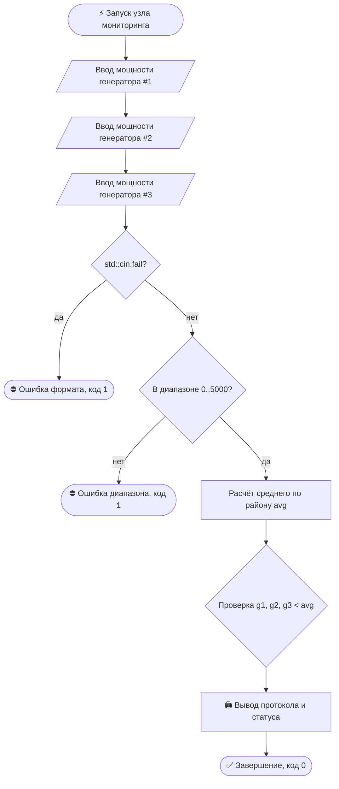

# ⚡ Энергосеть Киберпанка
### _Мониторинг распределения энергии в неоновом городе — консольное приложение на C++_


> [!QUOTE]+
> «Пока неон горит над Сектором-7 — компилятор не выдаёт ни одного предупреждения.»
> — надпись на терминале диспетчерской вышки

> [!INFO]- 🗺️ Содержание
> - [[#📖 Легенда|Легенда]]
> - [[#✨ Возможности|Возможности]]
> - [[#🔋 Параметры сети|Параметры сети]]
> - [[#🧮 Формула расчёта|Формула расчёта]]
> - [[#🚀 Сборка и запуск|Сборка и запуск]]
> - [[#📺 Демонстрация|Демонстрация]]
> - [[#🛡️ Валидация ввода|Валидация ввода]]
> - [[#🧠 Архитектура|Архитектура]]
> - [[#📄 Исходный код|Исходный код]]
> - [[#🔮 Roadmap диспетчерской|Roadmap]]

## 📖 Легенда

Ночь в мегаполисе. Неоновые вывески мигают на грани блэкаута, энергоблоки перегреваются, а дежурный оператор в третий раз вручную делит мегаватты на калькуляторе и теряет десятичные знаки.

==«Энергосеть Киберпанка»== — узел мониторинга, который берёт рутину на себя: считывает телеметрию трёх генераторов, вычисляет среднее потребление района и мгновенно выявляет просевшие энергоблоки. Счётные линейки — в утиль.

## ✨ Возможности

- [x] Ввод текущей мощности трёх генераторов района в мегаваттах (МВт) ⚡
- [x] Проверка рабочих границ оборудования: от `0.0` до `5000.0` МВт
- [x] Автоматический расчёт среднего потребления по району
- [x] Поиск всех генераторов с критически низким уровнем выработки (`g < avg`)
- [x] Определение приоритетного узла для экстренной диагностики
- [x] Понятные коды возврата: `0` — штатный мониторинг, `1` — ошибка ввода или выход за диапазон

## 🔋 Параметры сети
>Все показатели измеряются в мегаваттах (МВт)[^1].

|  #  | Параметр | Значение | Комментарий диспетчера |
| :-: | -------- | -------: | ---------------------- |
|  1  | 🔽 Минимальная мощность (`P_MIN`) | `0.0` МВт | Полная остановка или холостой ход турбины |
|  2  | 🔼 Максимальная мощность (`P_MAX`) | `5000.0` МВт | Предел прочности магистральных кабелей |
|  3  | 🏭 Количество генераторов | `3` шт. | Базовый контур питания неонового района |

> [!TIP] Границы меняются в одном месте
> Допустимые пределы мощности заданы константами `P_MIN` и `P_MAX` в начале `main()`. Пороги безопасности правятся без изменения логики расчёта.

## 🧮 Формула расчёта

$$
\text{avg} = \frac{g_1 + g_2 + g_3}{3.0}
$$

$$
\text{Критическое состояние: } g_i < \text{avg}, \qquad i \in \{1, 2, 3\}
$$

| Символ | Значение |
|:------:|----------|
| $g_1,\ g_2,\ g_3$ | текущая выработка генераторов #1, #2 и #3, МВт |
| $\text{avg}$ | среднее потребление электроэнергии по району, МВт |
| $\text{criticalCount}$ | общее число генераторов с просадкой мощности |
| $\text{firstCritical}$ | номер первого выявленного проблемного генератора |

> [!EXAMPLE]- 🧾 Пример: генераторы 1200, 850 и 1550 МВт
> $\text{avg} = \frac{1200 + 850 + 1550}{3.0} = \mathbf{1200.0}$ МВт → просадка у **генератора #2** ($850.0 < 1200.0$) → приоритетная диагностика: **генератор #2**

## 🚀 Сборка и запуск

```bash
g++ -std=c++17 -o cybergrid main.cpp

./cybergrid        # Linux / macOS
.\cybergrid.exe    # Windows (PowerShell)
```

> [!NOTE] Visual Studio
> Пустой консольный проект → добавить `main.cpp` → `Ctrl+F5`. Внешних зависимостей нет — только стандартная библиотека (`<iostream>`, `<iomanip>`).

> [!WARNING] Про ввод данных
> Весь ввод реализован через стандартный поток `std::cin >>` с проверкой флага `std::cin.fail()`. При попадании нечисловых символов в поток программа немедленно прерывает работу с кодом `1`.

> [!NOTE]- Про локаль и вывод кириллицы
> В начале `main()` вызывается `setlocale(0, "")` для корректного отображения кириллических сообщений в консоли Windows[^2]. Вещественные значения форматируются через `std::fixed` и `std::setprecision(2)`.

## 📺 Демонстрация

```text
=============================================
  ЭНЕРГОСЕТЬ КИБЕРПАНКА // MONITORING NODE   
=============================================
Введите мощность генератора #1 (МВт): 1200
Введите мощность генератора #2 (МВт): 850
Введите мощность генератора #3 (МВт): 1550

--- ПРОТОКОЛ МОНИТОРИНГА РАЙОНА ---
Генератор #1: 1200.00 МВт
Генератор #2: 850.00 МВт
Генератор #3: 1550.00 МВт
Среднее потребление района: 1200.00 МВт
[ALERT] Генератор #2: выработка ниже среднего района (850.00 МВт)

[СТАТУС] Обнаружено критических генераторов: 1
Приоритетная диагностика: генератор #2.
Требуется перераспределение нагрузки по районам.
=============================================
```

## 🛡️ Валидация ввода

| Ввод оператора | Реакция программы |
|----------------|-------------------|
| `1200`, `850`, `1550` | штатный расчёт и вывод протокола мониторинга, код `0` |
| `1000`, `1000`, `1000` | статус `[СТАТУС] Критических отклонений не обнаружено`, код `0` |
| `abc` (буквы или символы) | `ОШИБКА Некорректный ввод: ожидалось число.`, код `1` |
| `-50` (отрицательное число) | `ОШИБКА Мощность вне допустимого диапазона (0-5000 МВт).`, код `1` |
| `6500` (выше `P_MAX`) | `ОШИБКА Мощность вне допустимого диапазона (0-5000 МВт).`, код `1` |
| пустой Enter / EOF[^3] | остановка по `std::cin.fail()`, завершение с кодом `1` |

> [!IMPORTANT] Философия валидации
> Ошибка **типа данных** (буквы вместо чисел) → немедленная остановка с диагностикой и кодом `1`.
> Ошибка **диапазона** (отрицательная мощность или перегрузка свыше `5000` МВт) → аварийное прерывание мониторинга с кодом `1`. Безопасность сети превыше всего.

## 🧠 Архитектура



| Переменная / Константа | Назначение |
|------------------------|------------|
| `P_MIN`, `P_MAX` | константы границ допустимой мощности (`0.0` и `5000.0` МВт) |
| `g1`, `g2`, `g3` | измеренная мощность трёх генераторов района |
| `avg` | среднее потребление энергии по району |
| `criticalCount` | счётчик генераторов с выработкой ниже среднего |
| `firstCritical` | номер первого генератора для приоритетной диагностики |

## 📄 Исходный код

<details>
<summary>⚡ <b>main.cpp</b> — нажми, чтобы развернуть</summary>

```cpp
#include <iostream>
#include <iomanip>

int main() {

    setlocale(0, "");

    // диапазон мощности генератора
    const double P_MIN = 0.0;
    const double P_MAX = 5000.0;

    std::cout << "=============================================" << std::endl;
    std::cout << "  ЭНЕРГОСЕТЬ КИБЕРПАНКА // MONITORING NODE   " << std::endl;
    std::cout << "=============================================" << std::endl;

    double g1 = 0.0, g2 = 0.0, g3 = 0.0;


    std::cout << "Введите мощность генератора #1 (МВт): ";
    std::cin >> g1;
    if (std::cin.fail()) {
        std::cout << std::endl << "ОШИБКА Некорректный ввод: ожидалось число." << std::endl;
        return 1;
    }

    std::cout << "Введите мощность генератора #2 (МВт): ";
    std::cin >> g2;
    if (std::cin.fail()) {
        std::cout << std::endl << "ОШИБКА Некорректный ввод: ожидалось число." << std::endl;
        return 1;
    }

    std::cout << "Введите мощность генератора #3 (МВт): ";
    std::cin >> g3;
    if (std::cin.fail()) {
        std::cout << std::endl << "ОШИБКА Некорректный ввод: ожидалось число." << std::endl;
        return 1;
    }
    //Проверка диапазона
    if (g1 < P_MIN || g1 > P_MAX || g2 < P_MIN || g2 > P_MAX || g3 < P_MIN || g3 > P_MAX) {
        std::cout << std::endl << "ОШИБКА Мощность вне допустимого диапазона ("
            << P_MIN << "-" << P_MAX << " МВт). Мониторинг прерван." << std::endl;
        return 1;
    }

    // Расчет среднего потребления 
    double avg = (g1 + g2 + g3) / 3.0;

    std::cout << std::endl << "--- ПРОТОКОЛ МОНИТОРИНГА РАЙОНА ---" << std::endl;
    std::cout << std::fixed << std::setprecision(2);
    std::cout << "Генератор #1: " << g1 << " МВт" << std::endl;
    std::cout << "Генератор #2: " << g2 << " МВт" << std::endl;
    std::cout << "Генератор #3: " << g3 << " МВт" << std::endl;
    std::cout << "Среднее потребление района: " << avg << " МВт" << std::endl;

    // Поиск с критически низким уровнем
    int criticalCount = 0;
    int firstCritical = 0;

    if (g1 < avg) {
        std::cout << "[ALERT] Генератор #1: выработка ниже среднего района (" << g1 << " МВт)" << std::endl;
        criticalCount = criticalCount + 1;
        if (firstCritical == 0) {
            firstCritical = 1;
        }
    }
    if (g2 < avg) {
        std::cout << "[ALERT] Генератор #2: выработка ниже среднего района (" << g2 << " МВт)" << std::endl;
        criticalCount = criticalCount + 1;
        if (firstCritical == 0) {
            firstCritical = 2;
        }
    }
    if (g3 < avg) {
        std::cout << "[ALERT] Генератор #3: выработка ниже среднего района (" << g3 << " МВт)" << std::endl;
        criticalCount = criticalCount + 1;
        if (firstCritical == 0) {
            firstCritical = 3;
        }
    }


    if (criticalCount == 0) {
        std::cout << std::endl << "[СТАТУС] Критических отклонений не обнаружено." << std::endl;
        std::cout << "Все генераторы держат нагрузку. Неон города в безопасности." << std::endl;
    }
    else {
        std::cout << std::endl << "[СТАТУС] Обнаружено критических генераторов: " << criticalCount << std::endl;
        std::cout << "Приоритетная диагностика: генератор #" << firstCritical << "." << std::endl;
        std::cout << "Требуется перераспределение нагрузки по районам." << std::endl;
    }

    std::cout << "=============================================" << std::endl;
    return 0;
}
```

</details>

## 🔮 Roadmap диспетчерской

- [ ] Поиск генератора с абсолютным минимумом выработки (`min(g1, g2, g3)`)
- [ ] Автоматическая балансировка мощности между соседними секторами
- [ ] Логирование аварийных протоколов `[ALERT]` в файл телеметрии
- [ ] Поддержка произвольного числа генераторов через массивы или `std::vector`
- [ ] Режим симуляции перегрузки неоновой магистрали в час пик ⚡

## 📝 Сноски

[^1]: Мегаватт (МВт) — стандартная единица измерения мощности в энергосистеме мегаполиса.
[^2]: В Linux/macOS терминал по умолчанию работает в кодировке UTF-8, поэтому дополнительная настройка системной локали не требуется.
[^3]: Windows — `Ctrl+Z` и Enter; Linux/macOS — `Ctrl+D`.

---

*Проект учебный. Разработчик: Гемма Артём Сергеевич (вариант №4). Все совпадения с реальными энергосетями мегаполисов случайны.* ⚡
